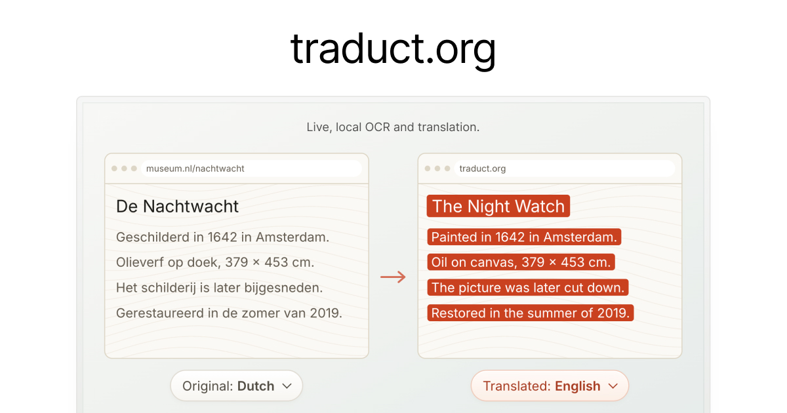

# traduct.org



Translate text in a shared window or screen as you read. traduct.org recognizes
text, translates it locally, and displays the translation over the video.
The text follows the page when you scroll.

Built by [Javier](https://javier.xyz). Find me on
[X (@javierbyte)](https://x.com/javierbyte).

## Getting started

Open [traduct.org](https://traduct.org) in Chrome on desktop, choose your languages, and share a window
or screen. The page fetches its two OCR models (about 6 MB) once, and Chrome
downloads the translation models the first time you use a language pair.

Supported languages: German, English, Spanish, French, Italian, Portuguese,
Dutch, and Chinese.

Chrome's Translator API requires free space for its models. The current
requirements are 22 GB free on the profile volume; Chrome removes downloaded
models if free space drops below 10 GB. The API is not available on mobile.

## Run locally

```sh
pnpm install
pnpm dev
```

To build and serve the production version:

```sh
pnpm build
pnpm preview
```

Open http://localhost:4173 after starting the preview server.

## Privacy

Screen capture and text recognition run on your device. Translation uses
Chrome's built-in `Translator` API. The app has no accounts, uploads,
analytics, or error reporting.

Your browser fetches the app and OCR models from the host. Chrome downloads
translation packs from Google. Those requests expose your IP address and
request metadata, but do not include captured pixels or recognized text.
Chrome's other traffic, such as Safe Browsing or profile sync, is separate.

OCR assets are pinned to SHA-256 hashes in
[asset-manifest.js](asset-manifest.js) and checked during the build and when
fetched. The app's Content Security Policy restricts connections to its own
origin. Run `pnpm test:privacy` to check the page's network requests in Chrome.

Chrome documents translation as local, but the page cannot inspect what runs
in the browser process. The
[Translator API specification](https://webmachinelearning.github.io/translation-api/)
leaves that implementation up to the browser. DevTools and the app's Content
Security Policy cannot verify it. You can check that translation works
locally by disconnecting from the network after downloading the models.

### Use offline

1. Run `pnpm install` and `pnpm build` while online.
2. Run `pnpm preview` and open http://localhost:4173.
3. Start a session and select your language pair to download its models.
   Some pairs translate through English and need two packs.
4. Once the models are ready, turn off Wi-Fi or block Chrome with a firewall.
   DevTools' offline setting only affects the renderer, so it does not test
   whether the browser process makes requests.
5. Share a window and translate.

Keep the local server running. The app has no service worker.

## How it works

1. **Capture.** The shared stream plays in a `<video>` element with
   `contentHint = "text"`.
2. **Cut the browser's toolbar.** When a browser window is shared, the tab
   strip and toolbar are found once a second (the first line that crosses the
   whole window, see [window-chrome.js](window-chrome.js)) and cut off: they
   are neither shown nor sampled nor read. This covers Chrome and Safari on macOS; when
   no toolbar edge is found, a 64px top margin is skipped instead. A 16px side
   margin and a 64px bottom margin are always skipped.
3. **Detect changes.** The OCR worker compares small samples up to 15 times
   per second. It detects changes and estimates how far the page scrolled.
4. **Track scrolling.** Existing translations move with the page so they stay
   readable while you scroll.
5. **Recognize text.** PP-OCRv6 "tiny" detection and recognition models
   (PaddleOCR, ONNX export from RapidOCR) run on ONNX Runtime WASM in a
   worker, driven by the small pipeline in [ocr-engine.js](ocr-engine.js).
   One model pair covers every offered language. Text is detected on a reduced
   copy of the frame, sized so the smallest text on screen stays about a dozen
   pixels tall and capped between 1.1 and 3 megapixels by processing time.
   Each detected box is then snapped to the pixels of its text in the full
   capture and cut from there, so small text on high-density displays stays
   legible, and a line produces the same crop wherever it is on screen. Lines
   are recognized in width-sorted batches, and a line that was read before is
   not read again: after a scroll only the lines that came into view are
   recognized. Lines cut off by the edge of the frame wait until they are
   fully visible.
6. **Group lines.** [layout.js](layout.js) joins lines into the paragraphs
   that are translated, using font size, line spacing, alignment and
   background. A line that left room for the next word ended its paragraph;
   list items, table cells and headings stay separate.
7. **Translate.** Paragraphs go to Chrome's `Translator` API. New text replaces
   stale pending batches, and results are cached for each language pair.
8. **Display.** The overlay reuses DOM nodes across frames and moves them
   together during scrolling.

Recognition runs in a worker to keep the interface responsive. The video
plays directly without being copied through a canvas. OCR currently uses
WASM; WebGPU is disabled.

Two benchmarks run in Chrome against pages in `fixtures/`:

- `node scripts/bench-pipeline.mjs` sends an article page through the real
  worker at 1x and 2x pixel density and at several scroll positions. It
  reports how many of the page's text blocks reach the translator intact,
  the character error rate, and the time of a first pass, a repeated pass and
  a pass after scrolling.
- `node scripts/bench-ocr.mjs` times the OCR engine alone and compares model
  variants, with line recall and character error rate.

## License

Copyright (C) 2026 Javier Bórquez.

[GPL-3.0](LICENSE). See [third-party notices](THIRD_PARTY_NOTICES.md) for
bundled models, libraries, and fonts.
